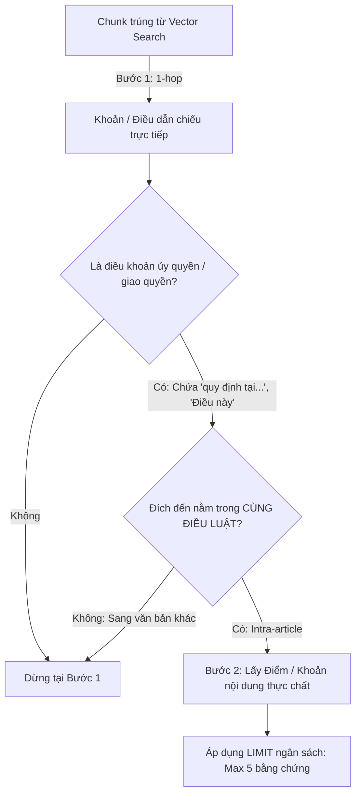

# Thiết kế Cơ chế Mở rộng Đồ thị (Graph Expansion) & Kiểm soát Giới hạn

Tài liệu thiết kế chi tiết cho thành phần Graph Retrieval trong hệ thống Hybrid RAG (Qdrant + Neo4j) của đề tài PBL6.

---

## 1. Mâu thuẫn bài toán (The Core Trade-off)

Trong việc mở rộng đồ thị pháp luật (Legal Knowledge Graph Traversal):
* **Nếu mở rộng quá ngắn (1-hop):**  
  Nhiều điều khoản trong văn bản hướng dẫn/dưới luật chỉ dẫn chiếu tới một điều khoản **ủy quyền / khung** (Delegation clause) của Luật cấp trên.  
  *Ví dụ điển hình:* Điều 1 Khoản 4 Thông tư 09/2020 dẫn chiếu tới **Khoản 3 Điều 147 Bộ luật Lao động 2019**.  
  Văn bản Khoản 3 chỉ ghi: *"Bộ trưởng Bộ Lao động - Thương binh và Xã hội quy định danh mục tại điểm h khoản 1 và điểm đ khoản 2 Điều này"*.  
  👉 Nếu chỉ dừng ở 1-hop, LLM chỉ thấy câu giao quyền mà **hoàn toàn không có nội dung thực chất của các công việc/nơi làm việc bị cấm**.
* **Nếu mở rộng tự do không kiểm soát (Unconstrained Multi-hop):**  
  Hệ thống luật có liên kết chéo dày đặc. Mỗi Điều dẫn chiếu 3-7 Điều khác. Sau 2-3 bước tự do:
  * Số lượng bằng chứng tăng theo cấp số nhân ($O(b^d)$).
  * Gây vòng lặp vô tận (Cypher query treo).
  * Làm tràn Context Window của LLM, gây loãng bối cảnh (**Semantic Drift**) và tăng chi phí token.

---

## 2. Bốn (4) Cơ chế Kiểm soát Bắt buộc (Guardrails)



### [1] Giới hạn độ sâu tối đa (Max Depth = 2)
* **Quy tắc:** Đồ thị chỉ được phép duyệt tối đa **2 bước (2-hop)**:
  $$\text{Chunk xuất phát (Thông tư)} \xrightarrow{\text{bước 1}} \text{Khoản dẫn chiếu (Luật)} \xrightarrow{\text{bước 2}} \text{Khoản/Điểm nội dung thực chất}$$
* Trong kỹ thuật lập pháp Việt Nam, chuỗi hướng dẫn thi hành luôn chạm đáy nội dung ở bước 2. Tuyệt đối không cho phép bước thứ 3.

### [2] Giới hạn phạm vi nội bộ Điều (Intra-article Constraint)
* Bước 2 chỉ được mở rộng nếu đích đến nằm trong **chính Điều luật đó** (`target.document_id = current.document_id AND target.article_number = current.article_number`).
* *Ý nghĩa:* Trong ví dụ Điều 147, Khoản 3 dẫn tới Điểm h Khoản 1 và Điểm đ Khoản 2 của **chính Điều 147**. Mở rộng trong nội bộ 1 Điều hoàn toàn an toàn, số lượng từ ngắn gọn, không thể gây lan truyền sang các văn bản xa lạ.

### [3] Ngân sách bằng chứng (Top-K / Token Budget)
* Khóa cứng số lượng node mở rộng trong câu Cypher:
  `LIMIT 5` (hoặc tối đa 8 node bổ trợ).
* Ưu tiên các quan hệ `IMPLEMENTS_COMPONENT` (quy định chi tiết) trước `CITES_COMPONENT` (viện dẫn thông thường).

### [4] Triệt tiêu chu trình (Cycle Prevention)
* Câu lệnh Cypher loại trừ toàn bộ các node đã xuất hiện trong danh sách kết quả vector ban đầu:
  `WHERE NOT target.id IN $visited_keys`

---

## 3. Kiến trúc Đề xuất cho Cypher Query (`REFERENCED_COMPONENTS_V2`)

```cypher
UNWIND $keys AS key
// Bước 1: Lấy các thành phần được dẫn chiếu trực tiếp
MATCH (c:SourceComponent {dataset_id: $dataset_id, document_id: key.document_id, article_number: key.meta_dieu})
WHERE c.point_number IS NULL AND (key.khoans IS NULL OR c.clause_number IS NULL OR c.clause_number IN key.khoans)
MATCH (c)-[r:CITES_COMPONENT|IMPLEMENTS_COMPONENT]->(t1:SourceComponent)
WHERE t1.article_number IS NOT NULL AND NOT (t1.document_id = key.document_id AND t1.article_number = key.meta_dieu)

// Bước 2 (Tùy chọn có điều kiện): Nếu t1 dẫn chiếu nội bộ tới điểm/khoản cụ thể trong cùng Điều
OPTIONAL MATCH (t1)-[r2:CITES_COMPONENT]->(t2:SourceComponent)
WHERE t2.document_id = t1.document_id 
  AND t2.article_number = t1.article_number 
  AND (t2.clause_number IS NOT NULL OR t2.point_number IS NOT NULL)

RETURN key.index AS index, 
       type(r) AS relation_hop1,
       t1.document_id AS doc_1, t1.article_number AS dieu_1, t1.clause_number AS khoan_1, t1.text AS text_1,
       t2.clause_number AS khoan_2, t2.point_number AS diem_2, t2.text AS text_2
LIMIT 8
```

---

## 4. Tóm tắt Trạng thái Triển khai

* **Cơ sở dữ liệu Neo4j Aura:** Đã có đầy đủ các node và cạnh dẫn chiếu cấp Khoản (`CITES_COMPONENT`, `IMPLEMENTS_COMPONENT`, `CONTAINS`).
* **Retrieval hiện tại:** Đang chạy ổn định ở mức 1-hop (đã kiểm thử thành công trên dữ liệu thật với độ trễ ~100ms).
* **Hành động tiếp theo:** Tích hợp logic 2-hop nội bộ có kiểm soát vào `labor_rag/retrieval/hybrid_retrieve.py` khi chuyển sang giai đoạn tối ưu hóa chất lượng truy vấn (P1.3).
