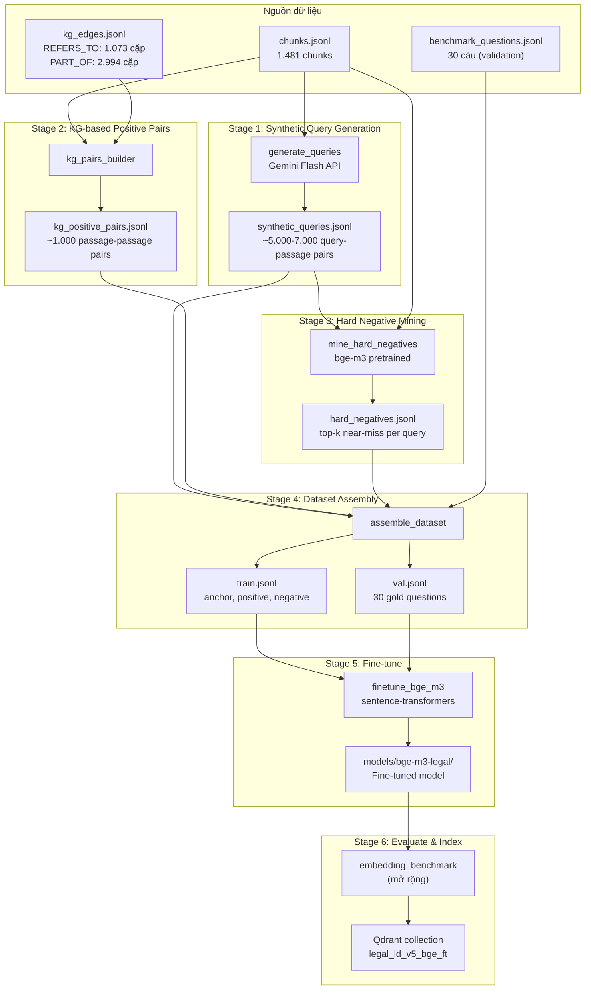

# Pipeline Data cho Fine-tune BGE-M3 trên dữ liệu Lao động

## Mục tiêu

Xây dựng pipeline tạo dữ liệu huấn luyện (training data) từ bộ dữ liệu pháp luật lao động hiện có (`chunks.jsonl`, `kg_edges.jsonl`, `kg_nodes.jsonl`) để fine-tune mô hình `BAAI/bge-m3` dùng cho giai đoạn **Vector Embedding** trong pipeline RAG. Mô hình sau fine-tune sẽ hiểu tốt hơn ngữ nghĩa pháp luật lao động Việt Nam, cải thiện Recall/MRR/nDCG so với bge-m3 gốc.

## Bối cảnh

### Dữ liệu hiện có
| Nguồn | Số lượng | Mô tả |
|---|---|---|
| [`chunks.jsonl`](file:///d:/Schools/PBL6/project/PBL6/data/processed/lao_dong_v5/chunks.jsonl) | 1.481 chunks | Mỗi chunk là 1 Điều (hoặc phần của Điều dài), text kèm ngữ cảnh |
| [`kg_edges.jsonl`](file:///d:/Schools/PBL6/project/PBL6/data/processed/lao_dong_v5/kg_edges.jsonl) | 18.400+ edges | REFERS_TO (1.073 cặp mapc↔mapc), PART_OF (27 chapters), CONTAINS, ... |
| [`kg_nodes.jsonl`](file:///d:/Schools/PBL6/project/PBL6/data/processed/lao_dong_v5/kg_nodes.jsonl) | 7.400+ nodes | Dieu, Chapter, Document, CrossReference... |
| [`benchmark_questions.jsonl`](file:///d:/Schools/PBL6/project/PBL6/labor_rag/evaluation/benchmark_questions.jsonl) | 30 câu hỏi | Gold labels (mapc → grade 1-3), dùng làm validation |

### Pipeline hiện tại (chưa fine-tune)
```
chunks.jsonl → bge-m3 (pretrained) → Qdrant → Vector Retrieval → Hybrid Retrieval → LLM
```

### Pipeline mục tiêu
```
chunks.jsonl + KG edges → Data Pipeline (MỚI) → training data
                                                      ↓
                                            bge-m3 (pretrained) → Fine-tune → bge-m3-legal
                                                                                    ↓
                                            chunks.jsonl → bge-m3-legal → Qdrant → Vector Retrieval (cải thiện)
```

## User Review Required

> [!IMPORTANT]
> **Synthetic query generation bằng LLM**: Pipeline sẽ dùng Gemini API (đã có trong `requirements.txt` qua `google-genai`) để tạo câu hỏi giả lập từ mỗi chunk. Mỗi chunk tạo 3-5 queries, tổng cộng ~5.000-7.000 queries. Chi phí API ước tính rất thấp (dưới $1 với Gemini Flash).

> [!IMPORTANT]
> **Train/validation split**: 30 câu hỏi v1 benchmark sẽ được giữ lại làm **validation set** (không dùng để train). Synthetic queries + KG-based pairs = **training set**.

> [!WARNING]
> **Thời gian fine-tune**: Với ~5.000 training samples, fine-tune bge-m3 trên GPU T4 (Modal) mất khoảng 30-60 phút. Trên CPU sẽ rất lâu (~nhiều giờ). Nên dùng Modal hoặc GPU local.

## Open Questions

> [!IMPORTANT]
> **GPU cho fine-tune**: Bạn có GPU local hay sẽ dùng Modal? Pipeline sẽ hỗ trợ cả hai, nhưng cần biết để cấu hình mặc định.

> [!IMPORTANT]
> **Số epochs & learning rate**: Mặc định sẽ dùng 3 epochs, lr=2e-5 (chuẩn cho sentence-transformers fine-tune). Bạn có muốn điều chỉnh không?

## Proposed Changes

### Tổng quan kiến trúc



---

### Component 1: Synthetic Query Generation

Module tạo câu hỏi tự nhiên (tiếng Việt) từ mỗi chunk bằng LLM, mô phỏng cách người dùng hỏi về nội dung pháp luật.

#### [NEW] `labor_rag/finetune/generate_queries.py`

**Input**: `chunks.jsonl`
**Output**: `data/processed/lao_dong_v5/finetune/synthetic_queries.jsonl`

Mỗi chunk tạo 3-5 queries với các style khác nhau (tương tự `STYLE_RATIOS` trong `build_testset.py`):

```python
QUERY_STYLES = {
    "tinh_huong": "Đặt câu hỏi dạng tình huống thực tế mà người lao động/doanh nghiệp gặp phải",
    "doi_thuong": "Đặt câu hỏi bằng ngôn ngữ đời thường, không dùng thuật ngữ pháp lý",
    "truc_tiep": "Hỏi trực tiếp về nội dung điều luật",
    "tu_khoa": "Hỏi ngắn gọn, chỉ dùng từ khóa chính",
    "da_dieu": "Hỏi câu hỏi cần kết hợp thông tin từ nhiều điều"
}
```

**Prompt template cho Gemini**:
```python
SYSTEM_PROMPT = """Bạn là chuyên gia pháp luật lao động Việt Nam.
Nhiệm vụ: từ một đoạn văn bản pháp luật, tạo {n} câu hỏi mà người dùng có thể hỏi
và đoạn văn bản này là câu trả lời đúng.

Yêu cầu:
- Câu hỏi phải tự nhiên, đa dạng phong cách
- KHÔNG copy nguyên văn từ điều luật
- Mỗi câu hỏi phải có thể trả lời được CHỈ bằng đoạn văn bản đã cho
- Trả về JSON array: [{"query": "...", "style": "..."}]
"""
```

**Format output**:
```json
{"query_id": "sq_145-2020-nd-cp_d10_1", "query": "Hợp đồng lao động bị tuyên vô hiệu trong trường hợp nào?", "chunk_id": "145-2020-nd-cp:d10", "style": "truc_tiep", "source": "synthetic"}
```

**Key design decisions**:
- Dùng `google-genai` (Gemini Flash 2.0) — đã có trong project dependencies
- Resumable: lưu progress, nếu bị ngắt thì chạy tiếp từ chunk chưa xử lý
- Rate limiting: 10 requests/giây (Gemini Flash free tier cho phép nhiều hơn)
- Batch: gom 3-5 chunks/request để giảm số API calls

---

### Component 2: KG-based Positive Pairs

Tận dụng Knowledge Graph để tạo thêm positive pairs — các cặp Điều có quan hệ pháp lý sẽ có embedding gần nhau.

#### [NEW] `labor_rag/finetune/kg_pairs.py`

**Input**: `chunks.jsonl`, `kg_edges.jsonl`
**Output**: `data/processed/lao_dong_v5/finetune/kg_positive_pairs.jsonl`

**3 loại positive pairs từ KG**:

| Loại | Nguồn | Số lượng ước tính | Ý nghĩa |
|---|---|---|---|
| **REFERS_TO** | 1.073 cặp mapc↔mapc | ~1.000 pairs | Hai Điều trích dẫn nhau → semantically related |
| **Same Chapter** | PART_OF → Chapter | ~500 pairs (sampling) | Hai Điều cùng chương → cùng chủ đề |
| **Same Document** | `document_id` field | ~300 pairs (sampling) | Hai Điều cùng nghị định/thông tư |

```python
def build_refers_to_pairs(chunks_by_mapc, edges):
    """Hai Điều trích dẫn nhau: (text_A, text_B) là positive pair."""
    pairs = []
    for edge in edges:
        if edge["type"] == "REFERS_TO":
            src, tgt = edge["source"], edge["target"]
            if src in chunks_by_mapc and tgt in chunks_by_mapc:
                pairs.append({
                    "anchor": chunks_by_mapc[src]["text"],
                    "positive": chunks_by_mapc[tgt]["text"],
                    "relation": "refers_to",
                    "anchor_mapc": src,
                    "positive_mapc": tgt,
                })
    return pairs

def build_chapter_pairs(chunks_by_mapc, edges, max_per_chapter=20):
    """Hai Điều cùng chương Pháp điển: soft positive pair (label thấp hơn)."""
    chapter_members = defaultdict(list)
    for edge in edges:
        if edge["type"] == "PART_OF" and "Chapter" in edge["target"]:
            chapter_members[edge["target"]].append(edge["source"])
    pairs = []
    for chapter, members in chapter_members.items():
        mapcs = [m for m in members if m in chunks_by_mapc]
        sampled = random.sample(list(combinations(mapcs, 2)),
                                min(max_per_chapter, len(mapcs) * (len(mapcs)-1) // 2))
        for a, b in sampled:
            pairs.append({
                "anchor": chunks_by_mapc[a]["text"],
                "positive": chunks_by_mapc[b]["text"],
                "relation": "same_chapter",
                "anchor_mapc": a,
                "positive_mapc": b,
            })
    return pairs
```

**Format output**:
```json
{"pair_id": "kg_refers_20.2.LQ.101_20.2.LQ.113", "anchor": "...", "positive": "...", "relation": "refers_to", "anchor_mapc": "20.2.LQ.101", "positive_mapc": "20.2.LQ.113"}
```

---

### Component 3: Hard Negative Mining

Dùng mô hình bge-m3 pretrained để tìm "hard negatives" — các chunks có vector gần nhưng KHÔNG phải câu trả lời đúng.

#### [NEW] `labor_rag/finetune/mine_negatives.py`

**Input**: `synthetic_queries.jsonl`, `chunks.jsonl`
**Output**: `data/processed/lao_dong_v5/finetune/hard_negatives.jsonl`

**Thuật toán**:
1. Encode tất cả 1.481 chunks bằng bge-m3 pretrained → corpus embeddings
2. Với mỗi synthetic query:
   - Encode query → query embedding
   - Top-20 cosine similarity từ corpus
   - Loại bỏ positive (chunk_id gốc + các chunks cùng Điều `article_id()`)
   - Giữ top-5 hard negatives (gần nhất nhưng sai)

```python
def mine_hard_negatives(queries, chunks, model, top_k=20, neg_k=5):
    """Tìm hard negatives cho mỗi query."""
    corpus_texts = [c["text"] for c in chunks]
    corpus_embeddings = model.encode(corpus_texts, normalize_embeddings=True)

    for query_row in queries:
        query_emb = model.encode(query_row["query"], normalize_embeddings=True)
        scores = cosine_similarity([query_emb], corpus_embeddings)[0]
        top_indices = scores.argsort()[::-1][:top_k]

        positive_article = article_id(query_row["chunk_id"])
        negatives = []
        for idx in top_indices:
            if article_id(chunks[idx]["chunk_id"]) != positive_article:
                negatives.append(chunks[idx]["chunk_id"])
            if len(negatives) >= neg_k:
                break
        yield {**query_row, "hard_negatives": negatives}
```

> [!TIP]
> Hard negatives là yếu tố quan trọng nhất cải thiện retrieval quality. Ví dụ: câu hỏi về "quyền nghỉ phép" có hard negative từ Điều về "thời giờ làm việc" — embedding phải phân biệt được hai khái niệm liên quan nhưng khác nhau.

---

### Component 4: Dataset Assembly

Gom tất cả nguồn thành training/validation set theo format `sentence-transformers`.

#### [NEW] `labor_rag/finetune/assemble_dataset.py`

**Input**: `synthetic_queries.jsonl`, `kg_positive_pairs.jsonl`, `hard_negatives.jsonl`, `benchmark_questions.jsonl`
**Output**: `data/processed/lao_dong_v5/finetune/train.jsonl`, `val.jsonl`, `dataset_stats.json`

**Training data format** — dùng `InputExample` của sentence-transformers:

**Phase 1 (Contrastive Learning cơ bản)**:
```json
{"anchor": "Người lao động bị sa thải khi nào?",
 "positive": "Lao động > Bộ luật Lao động > Chương VIII\nĐiều 125. Áp dụng hình thức xử lý kỷ luật sa thải\n..."}
```
→ Loss: `MultipleNegativesRankingLoss` (MNRL) — mỗi batch lấy positive của sample khác làm in-batch negatives.

**Phase 2 (+ Hard Negatives)**:
```json
{"anchor": "Người lao động bị sa thải khi nào?",
 "positive": "...Điều 125...",
 "negative": "...Điều 124. Hình thức xử lý kỷ luật lao động..."}
```
→ Loss: `TripletLoss` hoặc `MultipleNegativesRankingLoss` với hard negatives.

**KG pairs** (passage-passage contrastive):
```json
{"anchor": "...Điều 101 (trích dẫn Điều 113)...",
 "positive": "...Điều 113..."}
```
→ Loss: `MultipleNegativesRankingLoss` — dạy model rằng hai Điều liên quan pháp lý có embedding gần nhau.

**Validation set**: 30 câu v1 benchmark → dùng `InformationRetrievalEvaluator` tính Recall/MRR/nDCG trong quá trình train.

**Dataset statistics** (`dataset_stats.json`):
```json
{
    "total_train_samples": 6500,
    "synthetic_query_pairs": 5000,
    "kg_refers_to_pairs": 1000,
    "kg_chapter_pairs": 500,
    "hard_negative_samples": 5000,
    "validation_queries": 30,
    "corpus_size": 1481
}
```

---

### Component 5: Fine-tune Script

#### [NEW] `labor_rag/finetune/train.py`

**Input**: `train.jsonl`, `val.jsonl`
**Output**: `data/models/bge-m3-legal/`

```python
"""Fine-tune bge-m3 on Vietnamese labor law data.

Two-phase training:
1. Contrastive learning with MNRL loss (in-batch negatives)
2. Hard negative fine-tuning with TripletLoss

Usage:
    python -m labor_rag.finetune.train
    python -m labor_rag.finetune.train --epochs 5 --lr 1e-5 --batch-size 16
"""

def train(
    model_name: str = "BAAI/bge-m3",
    output_dir: Path = DATA_DIR / "models" / "bge-m3-legal",
    train_path: Path = FINETUNE_DIR / "train.jsonl",
    val_path: Path = FINETUNE_DIR / "val.jsonl",
    chunks_path: Path = CHUNKS_PATH,
    epochs: int = 3,
    lr: float = 2e-5,
    batch_size: int = 16,
    warmup_ratio: float = 0.1,
    phase: str = "both",  # "contrastive", "hard_neg", "both"
):
    model = SentenceTransformer(model_name)

    # Phase 1: Contrastive with MNRL
    train_contrastive = load_contrastive_examples(train_path)
    train_loss_mnrl = MultipleNegativesRankingLoss(model)

    # Phase 2: Hard negatives with TripletLoss
    train_hard_neg = load_triplet_examples(train_path)
    train_loss_triplet = TripletLoss(model, distance_metric=TripletDistanceMetric.COSINE)

    # Validation: IR evaluator from benchmark
    val_queries, val_corpus, val_relevant = load_ir_eval(val_path, chunks_path)
    evaluator = InformationRetrievalEvaluator(
        val_queries, val_corpus, val_relevant,
        name="labor-law-v1",
        main_score_function="cos_sim",
        ndcg_at_k=[10], mrr_at_k=[10], recall_at_k=[1, 5, 10],
    )

    # Train phase 1
    model.fit(
        train_objectives=[(DataLoader(train_contrastive, batch_size=batch_size, shuffle=True), train_loss_mnrl)],
        epochs=epochs,
        warmup_steps=int(len(train_contrastive) / batch_size * warmup_ratio),
        evaluator=evaluator,
        evaluation_steps=500,
        output_path=str(output_dir / "phase1"),
        optimizer_params={"lr": lr},
    )

    # Train phase 2 (from phase 1 checkpoint)
    model = SentenceTransformer(str(output_dir / "phase1"))
    model.fit(
        train_objectives=[(DataLoader(train_hard_neg, batch_size=batch_size, shuffle=True), train_loss_triplet)],
        epochs=max(1, epochs // 2),
        warmup_steps=int(len(train_hard_neg) / batch_size * warmup_ratio),
        evaluator=evaluator,
        evaluation_steps=500,
        output_path=str(output_dir),
        optimizer_params={"lr": lr / 2},  # lower LR for phase 2
    )
```

**Hyperparameters mặc định**:
| Param | Value | Lý do |
|---|---|---|
| `epochs` | 3 | Đủ để converge trên ~5K samples, tránh overfit |
| `lr` | 2e-5 | Standard cho sentence-transformers fine-tune |
| `batch_size` | 16 | Phù hợp GPU T4 16GB |
| `warmup_ratio` | 0.1 | 10% steps đầu tăng dần lr |
| `max_seq_length` | 1024 | Giữ nguyên max_seq_length của bge-m3 |

---

### Component 6: Tích hợp vào Pipeline hiện tại

#### [MODIFY] [`embedding_benchmark.py`](file:///d:/Schools/PBL6/project/PBL6/labor_rag/evaluation/embedding_benchmark.py)

Thêm model fine-tuned vào danh sách benchmark:

```diff
 MODELS: list[dict[str, str]] = [
     {
         "key": "bkai",
         "model": "bkai-foundation-models/vietnamese-bi-encoder",
         "collection": "legal_ld_v5_bkai",
     },
     {
         "key": "bge",
         "model": "BAAI/bge-m3",
         "collection": "legal_ld_v5_bge",
     },
+    {
+        "key": "bge_ft",
+        "model": "data/models/bge-m3-legal",
+        "collection": "legal_ld_v5_bge_ft",
+    },
     {
         "key": "mpnet",
         "model": "sentence-transformers/paraphrase-multilingual-mpnet-base-v2",
         "collection": "legal_ld_v5_mpnet",
     },
 ]
```

#### [MODIFY] [`embed_and_index.py`](file:///d:/Schools/PBL6/project/PBL6/labor_rag/ingest/embed_and_index.py)

Cho phép `--model data/models/bge-m3-legal` (đường dẫn local) → tạo collection `legal_ld_v5_bge_ft`.

#### [NEW] `labor_rag/finetune/__init__.py`

Package init.

---

### Cấu trúc thư mục mới

```
labor_rag/
├── finetune/                        # Package MỚI
│   ├── __init__.py
│   ├── generate_queries.py          # Stage 1: Synthetic query generation
│   ├── kg_pairs.py                  # Stage 2: KG-based positive pairs
│   ├── mine_negatives.py            # Stage 3: Hard negative mining
│   ├── assemble_dataset.py          # Stage 4: Gom thành train/val
│   └── train.py                     # Stage 5: Fine-tune bge-m3
data/
└── processed/lao_dong_v5/
    └── finetune/                    # Output directory (không commit lên git)
        ├── synthetic_queries.jsonl
        ├── kg_positive_pairs.jsonl
        ├── hard_negatives.jsonl
        ├── train.jsonl
        ├── val.jsonl
        └── dataset_stats.json
data/
└── models/
    └── bge-m3-legal/               # Fine-tuned model (không commit lên git)
```

---

### Lệnh chạy end-to-end

```powershell
# Stage 1: Tạo synthetic queries (~10 phút, cần GEMINI_API_KEY)
python -m labor_rag.finetune.generate_queries

# Stage 2: Tạo KG-based positive pairs (~30 giây)
python -m labor_rag.finetune.kg_pairs

# Stage 3: Mine hard negatives (~5 phút, cần GPU hoặc CPU)
python -m labor_rag.finetune.mine_negatives

# Stage 4: Gom dataset
python -m labor_rag.finetune.assemble_dataset

# Stage 5: Fine-tune (~30-60 phút trên GPU T4)
python -m labor_rag.finetune.train

# Stage 6: Đánh giá
python -m labor_rag.evaluation.embedding_benchmark --rebuild --model bge_ft
# So sánh với bge-m3 gốc:
python -m labor_rag.evaluation.embedding_benchmark --rebuild --model bge --model bge_ft
```

## Verification Plan

### Automated Tests

```powershell
# 1. Validate synthetic queries (format, không trùng, đủ styles)
python -m labor_rag.finetune.generate_queries --validate-only

# 2. Validate KG pairs (mapc tồn tại trong chunks)
python -m labor_rag.finetune.kg_pairs --validate-only

# 3. Validate assembled dataset (format sentence-transformers, train/val không overlap)
python -m labor_rag.finetune.assemble_dataset --validate-only

# 4. Validate fine-tuned model (load được, encode được, đúng dimension)
python -c "from sentence_transformers import SentenceTransformer; m = SentenceTransformer('data/models/bge-m3-legal'); print(m.get_sentence_embedding_dimension())"

# 5. Benchmark so sánh (Recall@10, MRR@10, nDCG@10 phải >= bge-m3 gốc)
python -m labor_rag.evaluation.embedding_benchmark --rebuild --model bge --model bge_ft --results-dir labor_rag/evaluation/results/finetune_comparison
```

### Manual Verification

1. **Kiểm tra chất lượng synthetic queries**: Mở `synthetic_queries.jsonl`, đọc 10-20 queries ngẫu nhiên → câu hỏi có tự nhiên không? Có trả lời được bằng chunk gốc không?
2. **Kiểm tra KG pairs**: Mở `kg_positive_pairs.jsonl` → hai Điều có thực sự liên quan về pháp lý không?
3. **Kiểm tra hard negatives**: Hard negatives có thực sự "khó" không (gần nhưng sai)?
4. **So sánh benchmark**: `summary.csv` — bge_ft phải có Recall@10, MRR@10, nDCG@10 cao hơn bge gốc
5. **Thử retrieval thực tế**: Chạy `python -m labor_rag.retrieval.hybrid_retrieve` với model fine-tuned, hỏi vài câu quen thuộc

### Tiêu chí thành công

| Metric | bge-m3 gốc (baseline) | bge-m3-legal (mục tiêu) |
|---|---|---|
| Recall@10 | (đo khi chạy) | ≥ baseline + 3% |
| MRR@10 | (đo khi chạy) | ≥ baseline + 2% |
| nDCG@10 | (đo khi chạy) | ≥ baseline + 2% |
