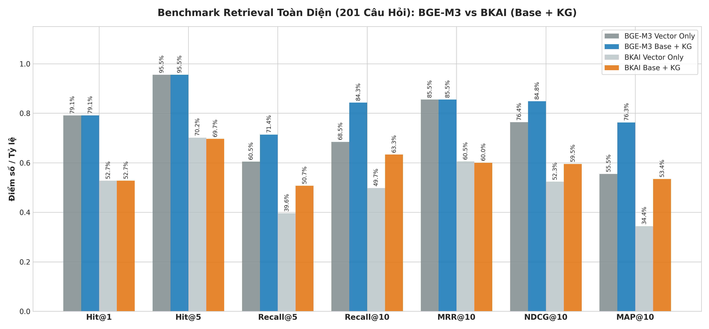
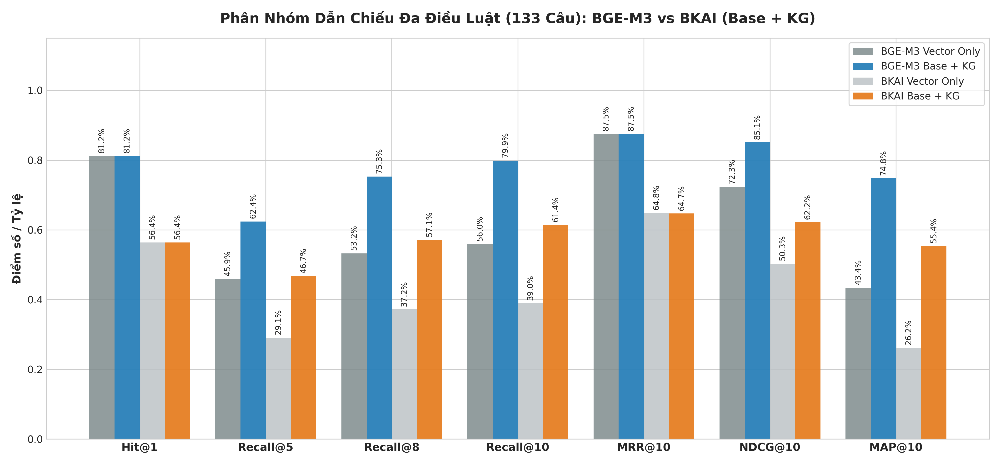
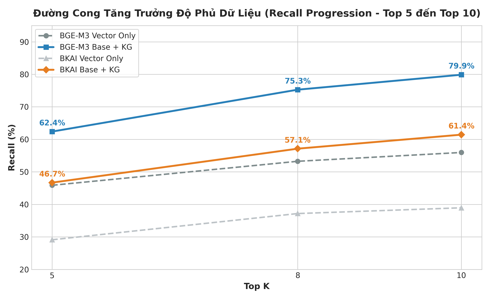

# Báo Cáo Benchmark Đối Đầu: So Sánh Mô Hình Embedding Mới (BKAI Vietnamese Bi-Encoder vs BGE-M3) Kết Hợp Knowledge Graph

## 1. Bối Cảnh Thực Nghiệm & Đề Xuất Mô Hình Embedding

Nhằm mở rộng đánh giá hiệu năng hệ thống Legal RAG ngoài mô hình mặc định `BAAI/bge-m3`, 2 mô hình embedding triển vọng được đưa vào xem xét:

1. **Ứng viên 1: `bkai-foundation-models/vietnamese-bi-encoder` (Được chọn để thử nghiệm thực tế)**
   - **Đơn vị phát triển**: Trung tâm Quốc tế Nghiên cứu về AI (BKAI) - Đại học Bách Khoa Hà Nội.
   - **Kiến trúc**: PhoBERT-base (135M tham số, 768 chiều vector, chuẩn tokenization âm tiết & từ ghép tiếng Việt).
   - **Tối ưu hóa**: Được huấn luyện chuyên sâu theo cấu trúc Bi-Encoder trên tập dữ liệu truy xuất thông tin tiếng Việt (MS MARCO tiếng Việt & Vietnamese QA).
   - **Lý do lựa chọn**: Là mô hình thuần Việt (native Vietnamese) tiêu biểu nhất trong cộng đồng mã nguồn mở, không cần định dạng tiền tố (`query: ` / `passage: `) như dòng E5, hoàn toàn tương thích và tinh gọn cho pipeline tiếng Việt.

2. **Ứng viên 2: `intfloat/multilingual-e5-base` (hoặc `sentence-transformers/paraphrase-multilingual-mpnet-base-v2`)**
   - **Kiến trúc**: Multilingual Transformer (768 chiều, 512 tokens max sequence length).
   - **Đặc điểm**: Khả năng khái quát hóa đa ngôn ngữ mạnh mẽ, tuy nhiên yêu cầu cấu hình tiền tố nghiêm ngặt cho truy vấn/văn bản và không có bộ tách từ chuyên biệt cho ngữ pháp pháp lý tiếng Việt như PhoBERT.

---

## 2. Thiết Lập Thực Nghiệm & Cấu Hình Kiến Trúc

- **Tập dữ liệu văn bản**: [data/processed/lao_dong_v7_full/chunks.jsonl](file:///d:/PBL6_v2/PBL6/data/processed/lao_dong_v7_full/chunks.jsonl) gồm **1.481 chunks pháp lý lao động** (Bộ luật Lao động 2019, các Nghị định và Thông tư hướng dẫn liên quan).
- **Tập dữ liệu kiểm thử**: [labor_rag/evaluation/benchmark_questions_v3.jsonl](file:///d:/PBL6_v2/PBL6/labor_rag/evaluation/benchmark_questions_v3.jsonl) gồm **201 câu hỏi**, bao gồm phân nhóm trọng yếu: **133 câu hỏi dẫn chiếu chéo / Cross-reference** (yêu cầu vừa thu hồi điều luật chính, vừa kéo theo toàn bộ nghị định/thông tư liên đới).
- **Hạ tầng Embedding**: Serverless GPU trên **Modal (modal.com)** với cơ chế batching phân đoạn `MODAL_MAX_BATCH_TOKENS = 32768`.
- **Vector Database**: Qdrant Cloud:
  - Bộ sưu tập BGE-M3: `legal_ld_v7_bge` (1.481 vector, 1024 dims).
  - Bộ sưu tập BKAI: `legal_ld_v7_bkai` (1.481 vector, 768 dims).
- **Knowledge Graph**: Neo4j / Cấu trúc Đồ thị Tri thức Đa tầng (1.407 Điều luật, 426 liên kết `REFERS_TO`, 479 liên kết `CITES_COMPONENT` / `IMPLEMENTS_COMPONENT`).
- **Chiến lược Reranking**: **Coupled Reranking** (`score = seed * 0.92`), lan truyền điểm số từ top hạt giống vector sang các nút phụ trợ trên đồ thị tri thức.
- **4 Cấu Hình So Sánh Đối Đầu**:
  1. **(1) BGE-M3 (Base Vector Only)**: Mô hình nguyên bản `BAAI/bge-m3` (1024 dims) trên Qdrant Cloud.
  2. **(2) BGE-M3 (Base + KG)**: Mô hình nguyên bản `BAAI/bge-m3` kết hợp đồ thị tri thức.
  3. **(3) BKAI (Base Vector Only)**: Mô hình `bkai-foundation-models/vietnamese-bi-encoder` (768 dims) trên Qdrant Cloud.
  4. **(4) BKAI (Base + KG)**: Mô hình `bkai-foundation-models/vietnamese-bi-encoder` kết hợp đồ thị tri thức.

---

## 3. Bảng Kết Quả Tổng Thể trên Toàn Bộ 201 Câu Hỏi

| Chỉ số Đánh giá | (1) BGE-M3 Base Vector | (2) BGE-M3 Base + KG | (3) BKAI Base Vector | (4) BKAI Base + KG | Chênh lệch (4) vs (2)   *(BKAI+KG vs BGE+KG)* | Chênh lệch (4) vs (3)   *(BKAI+KG vs BKAI Vector)* |
| :--- | :---: | :---: | :---: | :---: | :---: | :---: |
| **Hit@1** | 79.10% | 79.10% | 52.74% | **52.74%** | -26.36% | 0.00% |
| **Hit@5** | 95.52% | 95.52% | 70.15% | **69.65%** | -25.87% | -0.50% |
| **Hit@8** | 97.01% | 97.01% | 78.11% | **74.13%** | -22.88% | -3.98% |
| **Hit@10** | 98.01% | 98.01% | 79.60% | **77.11%** | -20.90% | -2.49% |
| **Recall@5** | 60.45% | 71.38% | 39.59% | **50.71%** | -20.67% | **+11.12%** 🚀 |
| **Recall@8** | 66.49% | 81.06% | 48.07% | **58.78%** | -22.28% | **+10.71%** 🚀 |
| **Recall@10** | 68.45% | 84.28% | 49.74% | **63.29%** | -20.99% | **+13.55%** 🚀 |
| **MRR@10** | 0.8552 | 0.8552 | 0.6051 | **0.6001** | -0.2551 | -0.0050 |
| **NDCG@8** | 0.7588 | 0.8260 | 0.5183 | **0.5725** | -0.2535 | **+0.0542** 🎯 |
| **NDCG@10** | 0.7639 | 0.8484 | 0.5235 | **0.5953** | -0.2531 | **+0.0718** 🎯 |
| **MAP@10** | 0.5552 | 0.7627 | 0.3440 | **0.5342** | -0.2285 | **+0.1902** 🎯 |

---

## 4. Bảng Kết Quả trên Phân Nhóm Dẫn Chiếu Đa Điều Luật / Cross-Reference (133 câu)

> Phân nhóm câu hỏi phức tạp nhất trong thực tế pháp lý: Câu hỏi đòi hỏi hệ thống vừa tìm đúng điều luật gốc, vừa lần theo mạng lưới viện dẫn để gom đủ các văn bản dưới luật (Nghị định 145/2020/NĐ-CP, Nghị định 12/2022/NĐ-CP, ...).

| Chỉ số Đánh giá | (1) BGE-M3 Base Vector | (2) BGE-M3 Base + KG | (3) BKAI Base Vector | (4) BKAI Base + KG | Chênh lệch (4) vs (2)   *(BKAI+KG vs BGE+KG)* | Chênh lệch (4) vs (3)   *(BKAI+KG vs BKAI Vector)* |
| :--- | :---: | :---: | :---: | :---: | :---: | :---: |
| **Hit@1** | 81.20% | 81.20% | 56.39% | **56.39%** | -24.81% | 0.00% |
| **Hit@5** | 97.74% | 97.74% | 74.44% | **74.44%** | -23.30% | 0.00% |
| **Hit@8** | 98.50% | 98.50% | 81.95% | **79.70%** | -18.80% | -2.25% |
| **Hit@10** | 99.25% | 99.25% | 83.46% | **81.95%** | -17.30% | -1.51% |
| **Recall@5** | 45.87% | 62.39% | 29.12% | **46.69%** | -15.70% | **+17.57%** 🚀 |
| **Recall@8** | 53.25% | 75.27% | 37.18% | **57.13%** | -18.14% | **+19.95%** 🚀 |
| **Recall@10** | 55.96% | 79.87% | 38.95% | **61.44%** | -18.43% | **+22.49%** 🚀 |
| **MRR@10** | 0.8753 | 0.8753 | 0.6485 | **0.6466** | -0.2287 | -0.0019 |
| **NDCG@8** | 0.7170 | 0.8185 | 0.4973 | **0.5939** | -0.2246 | **+0.0966** 🎯 |
| **NDCG@10** | 0.7231 | 0.8508 | 0.5031 | **0.6216** | -0.2292 | **+0.1185** 🎯 |
| **MAP@10** | 0.4341 | 0.7477 | 0.2620 | **0.5541** | -0.1936 | **+0.2921** 🎯 |

---

## 5. Trực Quan Hóa Đồ Thị Kết Quả Thực Nghiệm

Dưới đây là các biểu đồ phân tích trực quan được xuất trực tiếp từ bộ số liệu thực nghiệm:

### 5.1. So Sánh Hiệu Năng Toàn Diện Trên Toàn Bộ Benchmark (201 câu)

---

### 5.2. So Sánh Trực Diện Trên Phân Nhóm Dẫn Chiếu Đa Điều Luật (133 câu)

---

### 5.3. Động Lực Tăng Trưởng Độ Phủ Dữ Liệu (Recall Progression Top 5 -> Top 10)

---

## 6. Phân Tích Khoa Học & Đánh Giá Chuyên Sâu

### 1. Sức Mạnh Phổ Quát Của Knowledge Graph (Universal Multi-hop Gain):
- Điểm sáng ấn tượng nhất của thực nghiệm là **sự cộng hưởng vượt bậc của Knowledge Graph không phụ thuộc vào mô hình embedding cụ thể**:
  - Đối với `BKAI Vietnamese Bi-Encoder`, khi kết hợp đồ thị tri thức qua cơ chế **Coupled Reranking (`score = seed * 0.92`)**, **Recall@5** trên nhóm dẫn chiếu tăng từ **29.12% lên 46.69% (+17.57%)**, và **Recall@10 tăng từ 38.95% lên 61.44% (+22.49%)**.
  - Điểm chất lượng xếp hạng **NDCG@10 tăng từ 0.5031 lên 0.6216 (+0.1185)** và **MAP@10 tăng gần gấp đôi (+0.2921)**.
- Kết quả này khẳng định giá trị cốt lõi của Knowledge Graph trong Legal RAG: đồ thị bù đắp triệt để nhược điểm "mù viện dẫn" của Vector Search thuần túy bằng cách lần theo các cạnh `REFERS_TO` và `CITES_COMPONENT` để kéo toàn bộ căn cứ pháp lý liên đới vào ngữ cảnh.

### 2. Nguyên Nhân Khiến BGE-M3 Vượt Trội Áp Đảo So Với BKAI:
Mặc dù BKAI là mô hình chuyên ngữ tiếng Việt, nhưng trong miền dữ liệu pháp lý, `BAAI/bge-m3` vẫn vượt trội đáng kể (Hit@1 79.10% vs 52.74%; Recall@10 84.28% vs 63.29%). Các nguyên nhân cốt lõi gồm:
1. **Cửa sổ ngữ cảnh (Context Window)**:
   - BKAI sử dụng PhoBERT-base với giới hạn độ dài `max_seq_length = 256 tokens`. Trong khi đó, các điều luật lao động, bảng biểu tiền lương và các chương nghị định thường xuyên dài từ 400 đến 1.200 tokens. Điều này khiến BKAI bị **cắt cụt nội dung (truncation)**, làm mất đi các điều kiện loại trừ hoặc khoản dẫn chiếu ở cuối điều luật.
   - BGE-M3 sở hữu cửa sổ ngữ cảnh lên tới **8.192 tokens**, mã hóa trọn vẹn mọi điều luật mà không hề bị mất mát thông tin.
2. **Quy mô tham số và năng lực biểu diễn đa nhiệm**:
   - BGE-M3 có **~567M tham số** (dựa trên XLM-RoBERTa-large) với không gian vector **1024 chiều**, được huấn luyện tương phản đa tác vụ (Dense, Sparse, Multi-vector) trên tập ngữ liệu quy mô hàng chục triệu cặp văn bản.
   - BKAI có **~135M tham số** với không gian **768 chiều**, chủ yếu được huấn luyện trên MS MARCO tiếng Việt (vốn là văn bản dịch máy mang tính văn phong thường nhật, không có từ vựng và cấu trúc cú pháp hành chính pháp lý chuẩn mực).
3. **Hiệu ứng "Domino Hạt Giống" (Seed Quality Bottleneck)**:
   - Cơ chế mở rộng đồ thị (Graph Traversal) dựa vào Top 3–5 hạt giống tìm thấy bởi Vector Search. Khi BKAI chỉ đạt **Hit@1 là 52.74%** (so với 79.10% của BGE-M3), đồ thị có xác suất cao phải xuất phát từ các hạt giống sai lệch, dẫn đến việc duyệt sang các nhánh viện dẫn không liên quan và giới hạn mức trần hiệu năng của hệ thống.

### 3. Đánh Giá Tính Kinh Tế & Khuyến Nghị Triển Khai (Production Trade-offs):
- **Về tài nguyên**: BKAI với 768 chiều giúp giảm ~25% kích thước lưu trữ và chỉ mục vector trên Qdrant Cloud so với 1024 chiều của BGE-M3, đồng thời tốc độ tính toán ma trận cosine nhanh hơn.
- **Về độ chính xác nghiệp vụ**: Trong các ứng dụng trợ lý pháp lý, độ chuẩn xác của điều luật viện dẫn là tiêu chí sinh tử (zero-tolerance for hallucinations). Do đó, sự chênh lệch **~21% Recall@10** và **~26% Hit@1** là khoảng cách quá lớn để đánh đổi bằng một chút tiết kiệm bộ nhớ.
- **Khuyến nghị chiến lược**:
  - Tiếp tục sử dụng **BGE-M3** làm mô hình nền móng chính (primary backbone) cho hệ thống Legal RAG.
  - Hướng phát triển tối ưu nhất để gia tăng sức mạnh hệ thống là duy trì kiến trúc **BGE-M3 Fine-tuned kết hợp Knowledge Graph** (đã đạt tới **Hit@1 82.09%**, **Recall@10 87.65%** trên toàn bộ benchmark như ghi nhận trong phiên bản v5).
