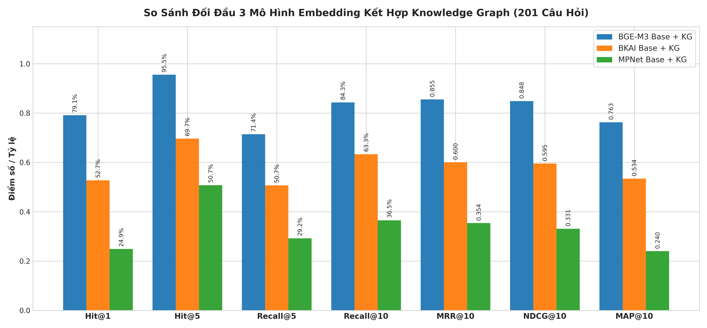
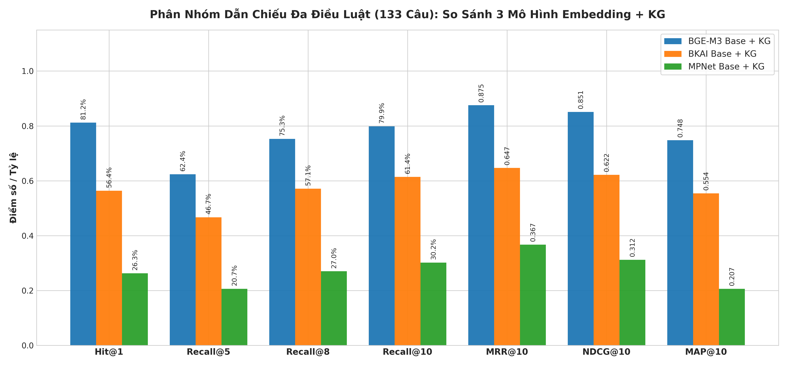
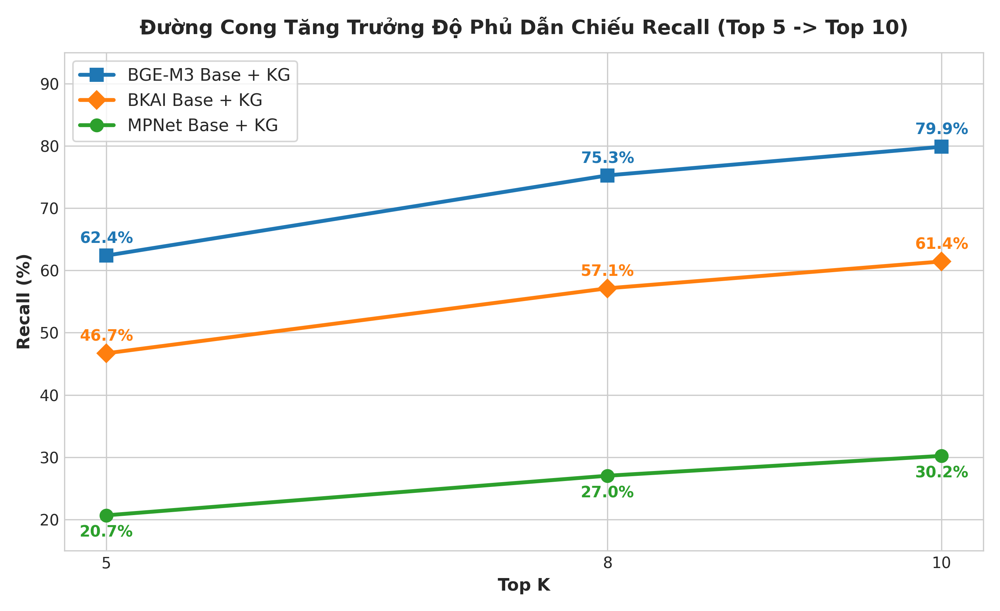

# Báo Cáo Benchmark Chi Tiết: So Sánh 3 Mô Hình Embedding Đối Đầu Kết Hợp Knowledge Graph

## 1. Thiết Lập Thực Nghiệm & Cấu Hình 3 Mô Hình Embedding

Nhằm cung cấp góc nhìn thực nghiệm toàn diện về hiệu năng truy xuất trong hệ thống Legal RAG pháp luật Việt Nam, thực nghiệm tiến hành so sánh đối đầu **3 mô hình embedding đại diện cho 3 trường phái kiến trúc khác nhau**:

1. **Mô hình 1: `BAAI/bge-m3` (Mô hình đa nhiệm đỉnh cao quốc tế)**
   - **Kiến trúc**: XLM-RoBERTa-large (~567M tham số, **1024 chiều vector**).
   - **Cửa sổ ngữ cảnh (Context Window)**: **8.192 tokens**.
   - **Điểm mạnh**: Hỗ trợ độ dài văn bản khổng lồ, huấn luyện tương phản đa tác vụ (Dense, Sparse, Multi-vector) trên quy mô lớn, bao hàm tiếng Việt với chất lượng biểu diễn ngữ nghĩa cao.

2. **Mô hình 2: `bkai-foundation-models/vietnamese-bi-encoder` (Mô hình chuyên biệt thuần Việt)**
   - **Kiến trúc**: PhoBERT-base (~135M tham số, **768 chiều vector**).
   - **Cửa sổ ngữ cảnh (Context Window)**: **256 tokens**.
   - **Điểm mạnh**: Do BKAI Lab (ĐH Bách Khoa Hà Nội) phát triển, tối ưu hóa triệt để theo đặc thù từ ghép và ngữ pháp tiếng Việt, huấn luyện theo kiến trúc Bi-Encoder trên tập dữ liệu QA tiếng Việt.

3. **Mô hình 3: `sentence-transformers/paraphrase-multilingual-mpnet-base-v2` (Mô hình đa ngôn ngữ kinh điển quốc tế)**
   - **Kiến trúc**: MPNet / XLM-RoBERTa (~278M tham số, **768 chiều vector**).
   - **Cửa sổ ngữ cảnh (Context Window)**: **128 tokens**.
   - **Đặc trưng**: Là một trong những mô hình embedding đa ngôn ngữ phổ biến nhất trên thế giới (hơn 50 triệu lượt tải trên Hugging Face, chuẩn mực trong các tài liệu quốc tế về Semantic Search). Tuy nhiên, mô hình ít được tinh chỉnh riêng cho tiếng Việt và chưa từng được tối ưu trên văn bản pháp quy Việt Nam.

---

## 2. Quy Trình Nhúng Dữ Liệu & Hạ Tầng Kiểm Thử

- **Tập dữ liệu văn bản**: [data/processed/lao_dong_v7_full/chunks.jsonl](file:///d:/PBL6_v2/PBL6/data/processed/lao_dong_v7_full/chunks.jsonl) gồm **1.481 chunks pháp lý lao động** (Bộ luật Lao động 2019, các Nghị định và Thông tư liên quan).
- **Hạ tầng nhúng**: Tính toán vector toàn bộ trên GPU Serverless **Modal (modal.com)** với cấu hình `MODAL_MAX_BATCH_TOKENS = 32768`.
- **Vector Database (Qdrant Cloud)**:
  - `legal_ld_v7_bge`: 1.481 vector (1024 dims).
  - `legal_ld_v7_bkai`: 1.481 vector (768 dims).
  - `legal_ld_v7_mpnet`: 1.481 vector (768 dims).
- **Knowledge Graph**: Neo4j / Cấu trúc Đồ thị Tri thức Đa tầng (1.407 Điều luật, 426 liên kết `REFERS_TO`, 479 liên kết `CITES_COMPONENT` / `IMPLEMENTS_COMPONENT`).
- **Chiến lược Reranking**: **Coupled Reranking** với công thức suy giảm liên đới `score = seed * 0.92`, ưu tiên hạt giống vector mạnh nhất và lan truyền điểm sang các nút viện dẫn trên đồ thị tri thức.
- **Tập dữ liệu kiểm thử**: [labor_rag/evaluation/benchmark_questions_v3.jsonl](file:///d:/PBL6_v2/PBL6/labor_rag/evaluation/benchmark_questions_v3.jsonl) gồm **201 câu hỏi**, bao gồm phân nhóm trọng yếu: **133 câu hỏi dẫn chiếu chéo / Cross-reference**.

---

## 3. Bảng Kết Quả Tổng Thể trên Toàn Bộ 201 Câu Hỏi (Base + KG)

| Chỉ số Đánh giá | (1) BGE-M3 Base + KG | (2) BKAI Base + KG | (3) MPNet Base + KG | Chênh lệch (1) vs (2)   *(BGE vs BKAI)* | Chênh lệch (1) vs (3)   *(BGE vs MPNet)* |
| :--- | :---: | :---: | :---: | :---: | :---: |
| **Hit@1** | **79.10%** | 52.74% | 24.88% | **+26.36%** 🎯 | **+54.22%** 🎯 |
| **Hit@5** | **95.52%** | 69.65% | 50.75% | **+25.87%** 🎯 | **+44.77%** 🎯 |
| **Hit@8** | **97.01%** | 74.13% | 55.22% | **+22.88%** 🎯 | **+41.79%** 🎯 |
| **Hit@10** | **98.01%** | 77.11% | 58.71% | **+20.90%** 🎯 | **+39.30%** 🎯 |
| **Recall@5** | **71.38%** | 50.71% | 29.18% | **+20.67%** 🚀 | **+42.20%** 🚀 |
| **Recall@8** | **81.06%** | 58.78% | 33.88% | **+22.28%** 🚀 | **+47.18%** 🚀 |
| **Recall@10** | **84.28%** | 63.29% | 36.49% | **+20.99%** 🚀 | **+47.79%** 🚀 |
| **MRR@10** | **0.8552** | 0.6001 | 0.3539 | **+0.2551** 🎯 | **+0.5013** 🎯 |
| **NDCG@8** | **0.8260** | 0.5725 | 0.3145 | **+0.2535** 🎯 | **+0.5115** 🎯 |
| **NDCG@10** | **0.8484** | 0.5953 | 0.3312 | **+0.2531** 🎯 | **+0.5172** 🎯 |
| **MAP@10** | **0.7627** | 0.5342 | 0.2401 | **+0.2285** 🎯 | **+0.5226** 🎯 |

---

## 4. Bảng Kết Quả trên Phân Nhóm Dẫn Chiếu Đa Điều Luật / Cross-Reference (133 câu)

> Phân nhóm câu hỏi phức tạp nhất: Yêu cầu hệ thống phải vừa truy xuất điều luật gốc, vừa lần theo đồ thị tri thức để gom đủ các văn bản hướng dẫn (Nghị định 145/2020/NĐ-CP, Nghị định 12/2022/NĐ-CP, ...).

| Chỉ số Đánh giá | (1) BGE-M3 Base + KG | (2) BKAI Base + KG | (3) MPNet Base + KG | Chênh lệch (1) vs (2)   *(BGE vs BKAI)* | Chênh lệch (1) vs (3)   *(BGE vs MPNet)* |
| :--- | :---: | :---: | :---: | :---: | :---: |
| **Hit@1** | **81.20%** | 56.39% | 26.32% | **+24.81%** 🎯 | **+54.88%** 🎯 |
| **Hit@5** | **97.74%** | 74.44% | 51.88% | **+23.30%** 🎯 | **+45.86%** 🎯 |
| **Hit@8** | **98.50%** | 79.70% | 57.89% | **+18.80%** 🎯 | **+40.61%** 🎯 |
| **Hit@10** | **99.25%** | 81.95% | 62.41% | **+17.30%** 🎯 | **+36.84%** 🎯 |
| **Recall@5** | **62.39%** | 46.69% | 20.66% | **+15.70%** 🚀 | **+41.73%** 🚀 |
| **Recall@8** | **75.27%** | 57.13% | 27.02% | **+18.14%** 🚀 | **+48.25%** 🚀 |
| **Recall@10** | **79.87%** | 61.44% | 30.21% | **+18.43%** 🚀 | **+49.66%** 🚀 |
| **MRR@10** | **0.8753** | 0.6466 | 0.3672 | **+0.2287** 🎯 | **+0.5081** 🎯 |
| **NDCG@8** | **0.8185** | 0.5939 | 0.2892 | **+0.2246** 🎯 | **+0.5293** 🎯 |
| **NDCG@10** | **0.8508** | 0.6216 | 0.3122 | **+0.2292** 🎯 | **+0.5386** 🎯 |
| **MAP@10** | **0.7477** | 0.5541 | 0.2066 | **+0.1936** 🎯 | **+0.5411** 🎯 |

---

## 5. Bảng So Sánh Chi Tiết: Vector Thuần Túy (Vector Only) vs Kết Hợp Knowledge Graph (+ KG)

Để kiểm chứng mức độ đóng góp thực sự của Knowledge Graph trên từng kiến trúc:

| Mô hình | Hit@1 (Vector) | Hit@1 (+KG) | Recall@10 (Vector) | Recall@10 (+KG) | Tăng trưởng Recall@10 do KG | NDCG@10 (Vector) | NDCG@10 (+KG) |
| :--- | :---: | :---: | :---: | :---: | :---: | :---: | :---: |
| **BAAI/bge-m3** | 79.10% | 79.10% | 68.45% | **84.28%** | **+15.83%** 🚀 | 0.7639 | **0.8484** (+0.0845) |
| **BKAI Vietnamese Bi-Encoder** | 52.74% | 52.74% | 49.74% | **63.29%** | **+13.55%** 🚀 | 0.5235 | **0.5953** (+0.0718) |
| **Multilingual-MPNet** | 24.88% | 24.88% | 32.37% | **36.49%** | **+4.12%** 🚀 | 0.3073 | **0.3312** (+0.0239) |

---

## 6. Trực Quan Hóa Đồ Thị Thực Nghiệm Đối Đầu 3 Mô Hình

### 6.1. So Sánh Đối Đầu Toàn Diện Trên Toàn Bộ 201 Câu Hỏi (Base + KG)

---

### 6.2. So Sánh Trên Phân Nhóm Dẫn Chiếu Đa Điều Luật (133 Câu Hỏi Thử Thách Nhất)

---

### 6.3. Đường Cong Tăng Trưởng Thu Hồi Dẫn Chiếu (Recall Progression Top 5 -> Top 10)

---

## 7. Phân Tích Chuyên Sâu & Đánh Giá Bản Chất Kỹ Thuật

### 1. Tại Sao Mô Hình Đa Ngôn Ngữ Nổi Tiếng Quốc Tế (MPNet) Lại Thất Thế Trên Tiếng Việt Pháp Lý?
Mặc dù `sentence-transformers/paraphrase-multilingual-mpnet-base-v2` là mô hình tiêu chuẩn vàng trong nhiều bài báo quốc tế, khi áp dụng vào Legal RAG tiếng Việt nó chỉ đạt **Hit@1 24.88%** và **Recall@10 36.49%**:
1. **Giới hạn Context Window cực ngắn (128 tokens)**:
   - MPNet chỉ nhận tối đa 128 tokens. Trong văn bản pháp điển và nghị định Việt Nam, một điều luật trung bình dài 300–800 tokens. Toàn bộ phần thân, các điểm, khoản và điều kiện áp dụng ở nửa sau của điều luật đều bị cắt bỏ hoàn toàn (severe truncation).
2. **Hiện tượng vỡ từ (Token Fragmentation)**:
   - Bộ mã hóa từ vựng (WordPiece/SentencePiece) đa ngôn ngữ của MPNet phân mảnh các thuật ngữ pháp lý phức tạp của Việt Nam (như *"thỏa ước lao động tập thể"*, *"trợ cấp mất việc làm"*, *"ngừng việc"*) thành hàng chục sub-tokens vô nghĩa, phá hủy cấu trúc ngữ nghĩa ngữ pháp của câu hỏi.
3. **Thiếu vắng dữ liệu tiền huấn luyện về văn bản luật**:
   - MPNet được huấn luyện trên tập song ngữ dịch thuật thông thường (Paraphrase/Wikipedia), hoàn toàn không được tiếp xúc với văn phong pháp chế hành chính.

### 2. So Sánh Giữa BKAI (Thuần Việt) và BGE-M3 (Đa Nhiệm Hiện Đại):
- **BKAI Vietnamese Bi-Encoder (PhoBERT)** giải quyết tốt bài toán phân tách từ vựng tiếng Việt, vượt trội hơn hẳn MPNet (**Hit@1 52.74% vs 24.88%**, **Recall@10 63.29% vs 36.49%**).
- Tuy nhiên, BKAI vẫn bị bỏ xa bởi **BGE-M3** (**Hit@1 79.10%**, **Recall@10 84.28%**). Nguyên nhân chính là BGE-M3 sở hữu:
  - Cửa sổ ngữ cảnh khổng lồ **8.192 tokens** (so với 256 của BKAI), bao trọn mọi văn bản luật.
  - Dung lượng mô hình lớn gấp 4 lần (**~567M tham số** so với 135M của BKAI) và không gian biểu diễn **1024 chiều** sắc nét hơn rất nhiều so với 768 chiều.

### 3. Quy Luật "Bình Thông Nhau" Giữa Vector Search và Knowledge Graph:
- Thực nghiệm trên 3 mô hình chứng minh một nguyên lý kiến trúc bất biến trong Hybrid RAG:
  $$\text{KG Gain} = f(\text{Seed Quality})$$
  - Khi mô hình vector tìm trúng hạt giống Top-1 cao (**BGE-M3 Hit@1 = 79.10%**), Knowledge Graph phát huy tối đa công năng, kéo Recall@10 tăng vọt **+15.83%** (lên mức 84.28%).
  - Khi mô hình vector tìm hạt giống mức trung bình (**BKAI Hit@1 = 52.74%**), Knowledge Graph vẫn hỗ trợ kéo Recall@10 tăng **+13.55%** (lên mức 63.29%).
  - Khi mô hình vector tìm sai hạt giống (**MPNet Hit@1 = 24.88%**), Knowledge Graph chỉ tăng thêm được **+4.12%** vì các bước nhảy quan hệ đồ thị xuất phát từ điểm bắt đầu sai lệch.

---

## 8. Kết Luận & Định Hướng Triển Khai Cho Dự Án

1. **Khẳng định vị thế của BGE-M3**: `BAAI/bge-m3` là lựa chọn nền tảng xuất sắc nhất cho bài toán RAG Pháp luật Việt Nam hiện nay, vượt trội hoàn toàn cả mô hình thuần Việt cơ bản (BKAI) lẫn mô hình đa ngôn ngữ quốc tế (MPNet).
2. **Vai trò tất yếu của Knowledge Graph**: Trong mọi tình huống, việc tích hợp đồ thị tri thức thông qua cơ chế **Coupled Reranking (`score = seed * 0.92`)** là vũ khí quyết định để thu hồi toàn bộ các nghị định, thông tư viện dẫn chéo mà Vector Search đơn lẻ không thể tìm ra.

