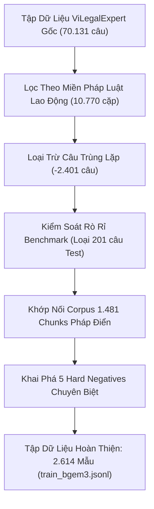
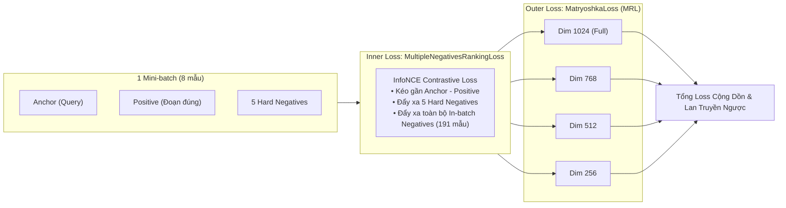

# Phân Tích Dữ Liệu & Chiến Lược Huấn Luyện Mô Hình BGE-M3 Fine-Tuning v2

Tài liệu này phân tích chi tiết bộ dữ liệu huấn luyện và giải thích toàn diện chiến lược kỹ thuật được triển khai trong notebook [notebooks/bge-m3_finetuningv2.ipynb](file:///d:/PBL6_v2/PBL6/notebooks/bge-m3_finetuningv2.ipynb) nhằm xây dựng mô hình embedding chuyên biệt cho pháp luật lao động Việt Nam (**Finetune v2** - `data/model2`).

---

## 1. Phân Tích Bộ Dữ Liệu Huấn Luyện (`train_bgem3.jsonl` / `train.jsonl`)

### 1.1. Nguồn Gốc và Quy Trình Lọc Dữ Liệu
Bộ dữ liệu được sử dụng trong notebook bắt nguồn từ tệp [data/processed/lao_dong_v5/finetune/train.jsonl](file:///d:/PBL6_v2/PBL6/data/processed/lao_dong_v5/finetune/train.jsonl) (kích thước xấp xỉ **34 MB**, gồm **2.614 mẫu**). 

Quy trình hình thành bộ dữ liệu trải qua các bước tinh lọc khắt khe:
1. **Khai thác từ tập pháp lý lớn**: Trích xuất từ tập dữ liệu quy chuẩn **ViLegalExpert** (tổng quy mô gốc gồm 70.131 truy vấn pháp lý).
2. **Lọc sạch rò rỉ dữ liệu (Data Leakage Filtering)**: Toàn bộ các câu hỏi thuộc tập benchmark kiểm thử độc lập (201 câu hỏi tại `benchmark_questions_v3.jsonl`) đều được loại trừ nghiêm ngặt ra khỏi tập huấn luyện để đảm bảo tính khách quan thực nghiệm.
3. **Loại bỏ trùng lặp (De-duplication)**: Loại bỏ 2.401 câu hỏi bị trùng lặp ngữ nghĩa hoặc có độ tương đồng quá cao.
4. **Khớp nối với Corpus Pháp luật Lao động**: Ghép nối 2.614 câu hỏi với kho 1.481 đoạn văn bản luật (chunks) thuộc hệ thống pháp điển lao động Việt Nam hiện hành.



---

### 1.2. Thống Kê & Cấu Trúc Chi Tiết
- **Tổng số mẫu**: **2.614 mẫu**.
- **Chia tập Train / Val trong notebook**:
  - **Tập Train (90%)**: **2.352 mẫu**.
  - **Tập Validation (10%)**: **262 mẫu** (cố định ngẫu nhiên với `seed=42`).
- **Phân bố văn bản quy phạm pháp luật trong tập dữ liệu**:
  - **Bộ luật Lao động 2019 (`45-2019-qh14`)**: 1.491 mẫu (~57.0%) — văn bản rường cột.
  - **Nghị định 145/2020/NĐ-CP** (hướng dẫn thi hành BLLĐ): 271 mẫu (~10.4%).
  - **Luật An toàn, vệ sinh lao động 2015 (`84-2015-qh13`)**: 267 mẫu (~10.2%).
  - **Luật Việc làm 2013 (`38-2013-qh13`)**: 251 mẫu (~9.6%).
  - **Nghị định 28/2015/NĐ-CP** (bảo hiểm thất nghiệp): 117 mẫu (~4.5%).
  - **Nghị định 152/2020/NĐ-CP** (người lao động nước ngoài): 90 mẫu (~3.4%).
  - Các Nghị định/Luật khác: 69/2020/QH14, 135/2020/NĐ-CP, 112/2021/NĐ-CP, 23/2021/NĐ-CP, 61/2015/NĐ-CP,...

---

### 1.3. Cấu Trúc Bản Ghi (Triplets with Multi Hard Negatives)
Mỗi mẫu dữ liệu được lưu dưới dạng một đối tượng JSON chuẩn hóa:

```json
{
  "id": "vle_61",
  "anchor": "Khi chấm dứt hợp đồng lao động thì các bên có thể kéo dài thời hạn thanh toán các khoản tiền có liên quan đến quyền lợi của mỗi bên không?",
  "positive": "Lao động > Bộ luật số 45/2019/QH14 > Chương III. HỢP ĐỒNG LAO ĐỘNG > Mục 3. CHẤM DỨT HỢP ĐỒNG LAO ĐỘNG\nĐiều 48. Trách nhiệm khi chấm dứt hợp đồng lao động\n1. Trong thời hạn 14 ngày làm việc...",
  "negatives": [
    "Lao động > Bộ luật số 45/2019/QH14 > Điều 36. Quyền đơn phương chấm dứt hợp đồng lao động...",
    "Lao động > Bộ luật số 45/2019/QH14 > Điều 41. Nghĩa vụ của người sử dụng lao động khi đơn phương chấm dứt...",
    "Lao động > Bộ luật số 45/2019/QH14 > Điều 97. Kỳ hạn trả lương...",
    "Lao động > Nghị định số 97/2022/NĐ-CP > Điều 14. Hiệu lực và trách nhiệm thi hành...",
    "Lao động > Bộ luật số 45/2019/QH14 > Điều 35. Quyền đơn phương chấm dứt hợp đồng lao động của NLĐ..."
  ],
  "type": "synthetic_query",
  "metadata": {
    "chunk_id": "45-2019-qh14:d48",
    "style": "truc_tiep"
  }
}
```

#### Phân Tích Ý Nghĩa & Vai Trò của Hard Negatives:
1. **Không sử dụng Random Negatives**: Các ví dụ đối nghịch (`negatives`) **không phải** là những đoạn văn bản ngẫu nhiên khác ngành luật (như Luật Hình sự hay Đất đai).
2. **Khai thác đối nghịch ngữ nghĩa sâu (Hard Negatives)**: Cả 5 đoạn văn bản trong `negatives` đều thuộc cùng lĩnh vực lao động, có tần suất từ khóa chồng lấn rất cao (đều chứa từ *"chấm dứt hợp đồng lao động"*, *"thanh toán tiền lương"*, *"quyền và nghĩa vụ"*).
3. **Mục tiêu huấn luyện**: Ép mô hình học cách phân biệt sự khác nhau giữa **Điều 48** (trách nhiệm thanh toán khi chấm dứt HĐLĐ) với **Điều 36/41** (quyền đơn phương chấm dứt) và **Điều 97** (kỳ hạn trả lương thông thường). Đây là nhân tố cốt lõi giúp mô hình không bị nhầm lẫn khi người dùng đặt câu hỏi tra cứu phức tạp.

---

## 2. Giải Thích Toàn Diện Chiến Lược Huấn Luyện (Training Strategy)

### 2.1. Có Đóng Băng (Freeze) Tầng Nào Không?

> [!IMPORTANT]
> **TRẢ LỜI: KHÔNG ĐÓNG BĂNG BẤT KỲ TẦNG NÀO (FULL-PARAMETER FINE-TUNING)**.
> 
> Trong toàn bộ quá trình thực thi của `bge-m3_finetuningv2.ipynb`, tất cả các tham số của mô hình backbone `BAAI/bge-m3` (~568 triệu tham số dựa trên kiến trúc XLM-RoBERTa 24 tầng) đều được cập nhật gradient (`requires_grad = True`).

#### Tại sao KHÔNG đóng băng tầng (No Layer Freezing)?
1. **Đặc thù ngôn ngữ pháp lý tiếng Việt**: Văn bản quy phạm pháp luật có cú pháp phân cấp chặt chẽ (Điều, Khoản, Điểm, Bộ luật, Nghị định) và sử dụng các đại từ, thuật ngữ chuyên biệt (*"người sử dụng lao động"*, *"trợ cấp thôi việc"*, *"hợp đồng lao động xác định thời hạn"*). Nếu đóng băng các tầng biến đổi biểu diễn ở đáy (bottom transformer layers), mô hình sẽ giữ nguyên biểu diễn đa ngữ tổng quát, không thể thích ứng sâu với cấu trúc phân cấp pháp điển.
2. **Tái cấu trúc không gian hình học embedding (Representation Geometry)**: Bài toán Dense Retrieval yêu cầu khoảng cách Cosine giữa câu hỏi người dân và điều luật tương ứng phải thật gần. Việc cập nhật đầy đủ 24 tầng giúp toàn bộ mạng nơ-ron định hình lại không gian vector tối ưu riêng cho pháp luật Việt Nam.
3. **Kiểm soát Overfitting mà không cần Freeze**: Thay vì đóng băng các tầng làm giới hạn khả năng học của mô hình, notebook áp dụng các kỹ thuật điều hòa (regularization) tiên tiến:
   - **Tốc độ học cực kỳ thận trọng**: `learning_rate = 2e-5` (tránh phá vỡ trọng số pretrained).
   - **Trọng số suy giảm (Weight Decay)**: `0.01` (chuẩn hóa $L_2$).
   - **Linear Warmup + Cosine Annealing Decay**: Khởi động êm ái ở 10% số bước đầu tiên, tránh hiện tượng quên kiến thức cũ (*Catastrophic Forgetting*).
   - **Số Epoch ngắn**: Chỉ huấn luyện `3 epochs`, vừa đủ để hội tụ trên 2.614 mẫu mà không gây học vẹt.
   - **Kỹ thuật Gradient Checkpointing**: Kích hoạt `gradient_checkpointing=True` giúp giải phóng ~30-40% bộ nhớ kích hoạt (activation memory), cho phép huấn luyện full-parameter mô hình 568M trên GPU phổ thông như NVIDIA Tesla T4 (15GB VRAM) mà không bị lỗi tràn bộ nhớ (Out-Of-Memory).

---

### 2.2. Chiến Lược Thiết Kế Hàm Mất Mát (Loss Function)

Mô hình kết hợp hai cơ chế hàm mất mát hiện đại bậc nhất trong lĩnh vực biểu diễn vector:

$$\mathcal{L}_{\text{Total}} = \mathcal{L}_{\text{Matryoshka}}\Big(\mathcal{L}_{\text{MultipleNegativesRankingLoss}}\Big)$$



#### 1. MultipleNegativesRankingLoss (MNRL - Inner Loss)
- Dựa trên nền tảng **InfoNCE Loss**. Với mỗi bộ ba $(q_i, p_i, \{n_{i,1}, \dots, n_{i,5}\})$:
  - Tích vô hướng $\text{sim}(q_i, p_i)$ được tối đa hóa.
  - Tích vô hướng với 5 mẫu hard negatives $\text{sim}(q_i, n_{i,k})$ bị phạt nặng.
  - **In-batch Negatives**: Tất cả các đoạn văn bản $p_j, n_{j,k}$ của các câu hỏi khác $j \neq i$ trong cùng batch cũng tự động trở thành các mẫu đối nghịch ngẫu nhiên. Với effective batch size = 32, mỗi câu hỏi được đối sánh cùng lúc với:
    $$1 \text{ positive} + 5 \text{ hard negatives} + (31 \times 6) \text{ in-batch negatives} = 192 \text{ văn bản}$$

#### 2. MatryoshkaLoss (MRL - Outer Loss)
- Thay vì chỉ tính loss trên toàn bộ 1024 chiều của vector, `MatryoshkaLoss` tính tổng tổn thất tại 4 kích thước cắt ngắn khác nhau:
  $$\mathcal{L}_{\text{Matryoshka}} = \mathcal{L}_{\text{MNRL}}^{(1024)} + \mathcal{L}_{\text{MNRL}}^{(768)} + \mathcal{L}_{\text{MNRL}}^{(512)} + \mathcal{L}_{\text{MNRL}}^{(256)}$$
- **Lợi ích chiến lược**:
  - **Nén ngữ nghĩa đa tầng**: Ép mạng nơ-ron phải dồn các đặc trưng quan trọng nhất vào 256 chiều đầu tiên, trong khi các chiều tiếp theo (đến 1024) chứa đựng thông tin ngữ cảnh bổ trợ chi tiết.
  - **Linh hoạt khi triển khai thực tế**: Cho phép hệ thống lưu trữ vector trên Qdrant Cloud hoặc Neo4j cắt giảm kích thước xuống **512 chiều** hoặc **768 chiều**, tiết kiệm từ 25% đến 50% chi phí RAM và tăng tốc độ tìm kiếm vector lên gấp 1.5 - 2 lần mà chất lượng thu hồi tài liệu hầu như không suy giảm.

---

### 2.3. Bảng Tổng Hợp Siêu Tham Số (Hyperparameters)

| Siêu tham số | Giá trị | Giải thích lý do lựa chọn |
| :--- | :---: | :--- |
| **Model Backbone** | `BAAI/bge-m3` | Pretrained đa ngôn ngữ SOTA, hỗ trợ độ dài ngữ cảnh lớn (8192 tokens). |
| **Max Seq Length** | `512` | Đảm bảo bao phủ >98% độ dài các điều luật trong pháp điển, tối ưu VRAM GPU. |
| **Num Epochs** | `3` | Đủ để học sâu miền pháp luật mà không làm mất tính tổng quát của mô hình gốc. |
| **Per-device Batch Size** | `8` | Kích thước batch tối đa vừa vặn với 15GB VRAM của card T4 (kèm 5 negatives). |
| **Gradient Accumulation** | `4` | Tích lũy gradient qua 4 bước $\rightarrow$ **Effective Batch Size = 32** ($8 \times 4$). |
| **Learning Rate** | `2e-5` | Mức học an toàn cho fine-tuning toàn bộ tham số của mô hình lớn 568M. |
| **Warmup Ratio** | `0.1 (10%)` | Tăng dần LR trong 10% số bước đầu tiên để ổn định trọng số ban đầu. |
| **LR Scheduler** | `cosine` | Giảm dần tốc độ học theo đường cong cosine mượt mà hơn hàm tuyến tính. |
| **Weight Decay** | `0.01` | Chuẩn hóa $L_2$ chống overfitting trên tập 2.614 mẫu. |
| **Optimizer** | `adamw_torch_fused` | Bản tối ưu GPU của AdamW, tăng tốc độ tính toán gradient ~15%. |
| **Mixed Precision** | `FP16` / `BF16` | Tự động nhận diện: `BF16` nếu chạy trên A100/L4, `FP16` nếu chạy trên T4. |
| **Gradient Checkpointing** | `True` | Tiết kiệm ~35% VRAM, cho phép full fine-tuning mô hình lớn 568M. |
| **Batch Sampler** | `no_duplicates` | Ngăn chặn việc hai câu hỏi trùng lặp xuất hiện cùng batch gây phạt nhầm. |

---

### 2.4. Quy Trình Đánh Giá & Chọn Mô Hình Tốt Nhất (Checkpointing & Evaluation)

1. **Bộ thẩm định độc lập (`val_data` - 262 mẫu)**:
   - Sử dụng lớp `InformationRetrievalEvaluator` của thư viện `sentence-transformers`.
   - Xây dựng một không gian truy xuất giả lập gồm 262 câu hỏi truy vấn và hàng nghìn đoạn văn bản pháp lý (chứa cả đáp án đúng lẫn toàn bộ các phân đoạn đối nghịch).
2. **Tần suất đánh giá**:
   - Cứ mỗi **37 steps** (tương đương 2 lần mỗi epoch), mô hình được kiểm tra tự động trên tập validation.
3. **Tiêu chí lưu mô hình (`metric_for_best_model`)**:
   - Căn cứ vào chỉ số **`val_legal_retrieval_ndcg@10`** (Normalized Discounted Cumulative Gain tại Top 10).
   - Tùy chọn `load_best_model_at_end = True` đảm bảo rằng sau khi kết thúc 3 epochs, mô hình được lưu lại là checkpoint đạt điểm NDCG@10 cao nhất trên tập kiểm thử, chứ không phải checkpoint ở bước cuối cùng (tránh nguy cơ overfit ở epoch 3).
4. **Quản lý dung lượng**:
   - `save_total_limit = 3`: Giữ lại tối đa 3 checkpoint tốt nhất để không làm đầy bộ nhớ Google Drive.

---

## 3. Bảng So Sánh Chiến Lược: Fine-Tuning v1 vs Fine-Tuning v2

| Tiêu chí | Bản v1 (`bge-m3-legal-vietnamese`) | Bản v2 (`bge-m3_finetuningv2.ipynb`) |
| :--- | :--- | :--- |
| **Cơ chế Huấn luyện** | `model.fit()` (API cũ của Sentence-Transformers v2) | `SentenceTransformerTrainer` (Dựa trên HuggingFace Trainer hiện đại) |
| **Cấu hình Tầng** | **Full fine-tuning** (Không đóng băng) | **Full fine-tuning** (Không đóng băng) |
| **Hàm Mất Mát (Loss)** | `MultipleNegativesRankingLoss` đơn thuần | **MatryoshkaLoss + MNRL** (Hỗ trợ 4 kích thước: 1024, 768, 512, 256) |
| **Số lượng Hard Negatives** | 3 đoạn văn bản / mẫu | **Tối đa 5 đoạn văn bản / mẫu** (Tăng độ khắt khe phân biệt) |
| **Batch Sampler** | Random Sampler mặc định | `no_duplicates` (Tránh phạt nhầm in-batch negatives) |
| **Lập Lịch Tốc Độ Học** | Tuyến tính (`linear`) | **Cosine Annealing** kết hợp Warmup 10% |
| **Tối Ưu Phần Cứng** | FP16 cơ bản | **BF16 / FP16 tự động + AdamW Fused + Gradient Checkpointing** |
| **Tiêu Chí Chọn Checkpoint** | Lưu mô hình sau bước train cuối cùng | Tự động đánh giá IR Evaluator liên tục, chọn **Best NDCG@10** |
| **Khả Năng Cắt Giảm Chiều** | Cố định 1024 chiều | **Linh hoạt**: Có thể chạy ở 1024, 768, 512 hoặc 256 chiều |

---

## 4. Kết Luận

1. **Bộ dữ liệu `train_bgem3.jsonl`** được chọn lọc có chủ đích với 2.614 mẫu pháp lý đa dạng và 5 hard negatives chất lượng cao cho mỗi mẫu, tạo môi trường rèn luyện khắt khe để mô hình nắm bắt ranh giới ngữ nghĩa tinh vi giữa các điều luật lao động.
2. **Chiến lược huấn luyện trong `bge-m3_finetuningv2.ipynb` KHÔNG hề đóng băng (freeze) bất kỳ tầng nào**, mà chọn phương pháp Full-Parameter Fine-Tuning có kiểm soát nghiêm ngặt bằng Learning Rate nhỏ (`2e-5`), Cosine Scheduler, Weight Decay và Gradient Checkpointing.
3. Việc ứng dụng **Matryoshka Representation Learning (MRL)** là bước cải tiến kiến trúc đột phá nhất, vừa nâng cao chất lượng biểu diễn ngữ nghĩa của vector 1024 chiều, vừa mang lại giải pháp tối ưu hạ tầng lưu trữ và tốc độ truy vấn khi triển khai thực tế trên Qdrant Cloud và Neo4j.

