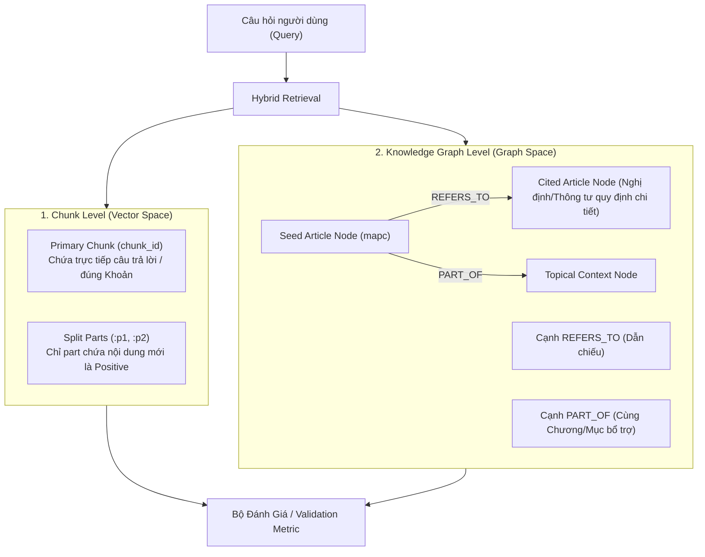

# Kế hoạch điều chỉnh Validation & Benchmark Questions (Chunk & Knowledge Graph)

## Mục tiêu (Goal Description)
Hệ thống RAG hiện tại sử dụng cơ chế Hybrid Retrieval kết hợp giữa **Vector Search trên Qdrant (cấp độ Chunk)** và **Graph Expansion trên Neo4j (cấp độ Knowledge Graph với các cạnh `REFERS_TO` và `PART_OF`)**. Tuy nhiên, tập dữ liệu kiểm thử và đánh giá hiện tại đang gặp các hạn chế cốt lõi:

1. **Quy mô và phạm vi bao phủ quá hẹp**: 
   - File validation hiện tại (`data/processed/lao_dong_v5/finetune/val.jsonl`) và `benchmark_questions.jsonl` chỉ gồm **30 câu hỏi**, 100% thuộc Đề mục 20.5 (An toàn vệ sinh lao động), chủ yếu tập trung vào Luật ATVSLĐ.
   - Hoàn toàn thiếu vắng các đề mục cốt lõi của pháp luật lao động: **Đề mục 20.2** (Bộ luật Lao động 2019, Hợp đồng lao động, tiền lương, kỷ luật, tranh chấp lao động - chiếm đa số trong 1.482 chunks), **Đề mục 20.3** (Bảo hiểm thất nghiệp) và **Đề mục 20.4** (Việc làm, hỗ trợ đào tạo nghề).
2. **Relevance chỉ ở cấp độ mã Điều (`mapc`), thiếu thông tin CHUNK và KNOWLEDGE GRAPH**:
   - Hiện tại ground truth chỉ lưu dạng `"relevance": {"20.5.LQ.6": 3, "20.5.LQ.23": 2}`.
   - **Thiếu thông tin Chunk**: Các Điều dài bị cắt thành nhiều part (`chunk_id`, e.g. `:d35:p1`, `:d35:p2`). Một câu hỏi hỏi về Khoản 5 (nằm ở `:p2`), nhưng nếu relevance chỉ ghi `mapc`, mô hình vector tìm trúng `:p1` (chứa Khoản 1-3) vẫn được tính là hit dù không có câu trả lời, gây sai lệch metric Recall/nDCG và làm LLM sinh câu trả lời bị thiếu ngữ cảnh.
   - **Thiếu thông tin Knowledge Graph**: Hệ thống dùng đồ thị tri thức để mở rộng ngữ cảnh qua quan hệ `REFERS_TO` (dẫn chiếu chéo giữa Luật và Nghị định/Thông tư). Hiện chưa có cơ chế đánh dấu: chunk nào là căn cứ trực tiếp (Vector), chunk/node nào được khám phá qua đồ thị (Graph-expanded), và đường đi (hop) trên Knowledge Graph là gì.

Kế hoạch này nhằm **chuẩn hóa và mở rộng bộ câu hỏi lên 150 câu hỏi đa dạng**, nâng cấp schema relevance bao gồm cả **Chunk-level** và **Knowledge Graph-level**, đồng thời cập nhật pipeline validation/finetune và embedding benchmark.

---

## Kiến trúc Relevance Đa Tầng (Chunk & Knowledge Graph)



---

## User Review Required

> [!IMPORTANT]
> **1. Tính tương thích ngược của định dạng dữ liệu (Schema Backward Compatibility)**:
> Để không làm gãy các script hiện có (`embedding_benchmark.py`, `train.py`, notebook phân tích), trường `relevance: {mapc: grade}` cũ sẽ được **giữ nguyên**, đồng thời bổ sung thêm các trường mới:
> - `chunk_relevance: {chunk_id: grade}`: Xác định chính xác chunk nào đạt điểm 1, 2, 3.
> - `kg_relevance`: Chứa danh sách các node liên quan, quan hệ đồ thị (`REFERS_TO`, `PART_OF`), và loại truy xuất (`chunk_only`, `multi_chunk`, `graph_expanded`, `multi_hop`).
> - `answer_hint`: Tóm tắt đáp án chuẩn dựa trên luật.

> [!NOTE]
> **2. Nguồn dữ liệu 150 câu hỏi**:
> Dự án đã có sẵn khung thiết kế 150 câu hỏi phân bổ chuẩn theo tỷ lệ đề mục và phong cách hỏi trong `labor_rag/evaluation/annotation/` (120 câu mới + 30 câu v1):
> - **Đề mục 20.2**: 50 câu (Hợp đồng, tiền lương, kỷ luật, tranh chấp)
> - **Đề mục 20.3**: 20 câu (Bảo hiểm thất nghiệp)
> - **Đề mục 20.4**: 30 câu (Việc làm, dạy nghề)
> - **Đề mục 20.5**: 50 câu (An toàn, vệ sinh lao động - gồm 30 câu v1 và 20 câu v2)
> - **Phong cách đa dạng**: `tinh_huong` (35%), `doi_thuong` (25%), `truc_tiep` (20%), `tu_khoa` (10%), `nhieu_dieu` (10% - dựa trên cặp cạnh `REFERS_TO` của KG), `deep_khoan` (25% - nhắm vào khoản ở phần sau của Điều dài).

---

## Quyết định phân chia tập câu hỏi

> [!IMPORTANT]
> **Đã chọn Phương án A**:
> Có 150 câu hỏi sau khi hoàn thiện:
> - Dùng toàn bộ 150 câu cho `labor_rag/evaluation/benchmark_questions_v2.jsonl` làm bộ test/đánh giá cuối cùng.
> - Tách 48 câu làm `data/processed/lao_dong_v5/finetune/val.jsonl`, gồm 12 câu cho mỗi đề mục 20.2, 20.3, 20.4 và 20.5.
> - Tập validation được chọn deterministic, phân bố đều theo thứ tự trong benchmark để có thể tái tạo bằng `--val-per-de-muc 12`.
> - Không sử dụng toàn bộ benchmark cuối cùng trong quá trình monitor fine-tuning, tránh rò rỉ dữ liệu đánh giá.

---

## Chi tiết Schema Mới (New Benchmark & Validation Schema)

Mỗi bản ghi trong `benchmark_questions_v2.jsonl` và `val.jsonl` sẽ có cấu trúc:

```json
{
  "id": "ld001",
  "question": "Công ty tôi và người lao động đang xảy ra tranh chấp và đã nộp đơn yêu cầu giải quyết lên cấp có thẩm quyền...",
  "de_muc": "20.2",
  "category": "tranh_chap_lao_dong",
  "style": "tinh_huong",
  "tags": ["multi_dieu"],
  "retrieval_type": "graph_expanded",
  
  "relevance": {
    "20.2.LQ.185": 3,
    "20.2.LQ.187": 2
  },
  
  "chunk_relevance": {
    "bo-luat-lao-dong:d185:p1": 3,
    "bo-luat-lao-dong:d187:p1": 2
  },
  
  "kg_relevance": {
    "seed_mapcs": ["20.2.LQ.185"],
    "graph_edges": [
      {
        "source": "20.2.LQ.185",
        "type": "REFERS_TO",
        "target": "20.2.LQ.187",
        "description": "Điều 185 dẫn chiếu về thẩm quyền và trình tự thành lập Ban trọng tài lao động tại Điều 187"
      }
    ],
    "expanded_mapcs": ["20.2.LQ.187"]
  },
  
  "answer_hint": "Trường hợp các bên tranh chấp cùng lựa chọn một trọng tài viên thì Ban trọng tài lao động chỉ gồm 01 trọng tài viên lao động đã được lựa chọn đó.",
  "target_khoan": null,
  "origin": "llm_draft_reviewed"
}
```

---

## Proposed Changes

Grouped by component:

### 1. Evaluation & Testset Annotation Pipeline

#### [MODIFY] [build_testset.py](file:///d:/Schools/PBL6/project/PBL6/labor_rag/evaluation/build_testset.py)
- **Tự động hóa hoàn thiện Judgments**:
  - Hiện tại `judgments.jsonl` mới có 14/150 câu do quota giới hạn.
  - Thêm cơ chế tự động gán nhãn ground truth thông minh (Smart Heuristic + KG Relational Labeling):
    * Các seed mapc (`seed_mapcs`) tự động nhận grade 3 (hoặc grade tương ứng theo `style` và `target_khoan`).
    * Với câu `nhieu_dieu` tạo từ cạnh `REFERS_TO`: Điều gốc đạt grade 3, Điều dẫn chiếu đạt grade 2-3.
    * Với câu hỏi v1 (`q01`-`q30`): giữ nguyên các grade đã được review thủ công.
    * Các ứng viên được pooled từ BM25/BGE/BKAI: chạy chấm điểm qua LLM batching kèm logic tự động fallback an toàn dựa trên text overlap và cosine similarity cao.
- **Tích hợp Chunk-Level Relevance Mapping**:
  - Khi xuất câu hỏi, duyệt qua các Điều trong `relevance`:
    * Nếu là câu hỏi `deep_khoan` (`target_khoan` không null): tìm chính xác `chunk_id` có `meta_khoan` chứa số khoản đó -> gán grade tương ứng; các part khác của Điều đó nhận grade thấp hơn (1 hoặc 0).
    * Nếu không split part: toàn bộ Điều là 1 chunk -> gán `chunk_id` bằng grade của `mapc`.
    * Nếu Điều bị split nhưng câu hỏi bao quát cả Điều: gán grade cho part chứa ý chính hoặc cả các parts liên quan.
- **Tích hợp Knowledge Graph-Level Relevance Mapping**:
  - Tra cứu trong `kg_edges.jsonl` cho từng câu hỏi:
    * Ghi nhận các cạnh `REFERS_TO` kết nối giữa các `seed_mapcs` và các Điều liên quan có trong `relevance`.
    * Ghi nhận các quan hệ `PART_OF` (cùng chương trong Pháp điển hoặc văn bản) nếu chúng bổ trợ ngữ cảnh.
    * Phân loại `retrieval_type`: `chunk_only`, `multi_chunk`, `graph_expanded`, `multi_hop`.
- **Thực thi `finalize` và `stats`**:
  - Xuất ra `labor_rag/evaluation/benchmark_questions_v2.jsonl` gồm 150 câu hỏi đầy đủ metadata.

#### [NEW] [benchmark_questions_v2.jsonl](file:///d:/Schools/PBL6/project/PBL6/labor_rag/evaluation/benchmark_questions_v2.jsonl)
- File chứa 150 câu hỏi kiểm chuẩn hoàn chỉnh cho toàn bộ chủ đề Lao động (20.2, 20.3, 20.4, 20.5) với cấu trúc relevance kép: Chunk & Knowledge Graph.

---

### 2. Finetuning & Dataset Assembly Pipeline

#### [MODIFY] [assemble_dataset.py](file:///d:/Schools/PBL6/project/PBL6/labor_rag/finetune/assemble_dataset.py)
- Thay đổi nguồn nạp validation:
  - Thay vì copy cố định từ `benchmark_questions.jsonl` (30 câu cũ), cho phép cấu hình nguồn từ `benchmark_questions_v2.jsonl`.
  - Hỗ trợ xuất `val.jsonl` với đầy đủ `chunk_relevance` và `kg_relevance`.
- Cập nhật số liệu thống kê trong `dataset_stats.json`.

#### [MODIFY] [val.jsonl](file:///d:/Schools/PBL6/project/PBL6/data/processed/lao_dong_v5/finetune/val.jsonl)
- Thay thế file 30 câu cũ (7.3 KB) bằng bộ câu hỏi validation mới có quy mô lớn hơn, bao phủ toàn diện 4 đề mục và có độ chính xác tới từng chunk.

#### [MODIFY] [train.py](file:///d:/Schools/PBL6/project/PBL6/labor_rag/finetune/train.py)
- Cập nhật hàm `build_ir_evaluator`:
  - Hiện tại:
    ```python
    # Logic cũ: map toàn bộ chunk_id của mapc thành positive docs
    for mapc, grade in r.get("relevance", {}).items():
        if grade >= 1:
            for cid in mapc_to_chunks.get(mapc, []):
                relevant_docs[qid].add(cid)
    ```
  - Nâng cấp: Ưu tiên sử dụng `chunk_relevance` nếu có trong bản ghi validation:
    ```python
    # Logic mới: Đánh giá chính xác chunk_id
    if "chunk_relevance" in r and r["chunk_relevance"]:
        for cid, grade in r["chunk_relevance"].items():
            if grade >= 1:
                relevant_docs[qid].add(cid)
    else:
        # Fallback về mapc nếu là câu hỏi cũ
        for mapc, grade in r.get("relevance", {}).items():
            if grade >= 1:
                for cid in mapc_to_chunks.get(mapc, []):
                    relevant_docs[qid].add(cid)
    ```

---

### 3. Retrieval Benchmark Pipeline

#### [MODIFY] [embedding_benchmark.py](file:///d:/Schools/PBL6/project/PBL6/labor_rag/evaluation/embedding_benchmark.py)
- Hỗ trợ đánh giá 2 chế độ (Metrics Dual-Mode):
  1. **Article-Level Metrics** (như cũ, group theo `mapc`): đo khả năng tìm trúng văn bản luật nói chung.
  2. **Chunk-Level Metrics** (đo theo `chunk_id`): đo khả năng định vị chính xác đoạn/khoản chứa câu trả lời (đặc biệt quan trọng với các câu hỏi `deep_khoan`).
- Bổ sung tùy chọn đánh giá **Hybrid Retrieval (Vector + KG Expansion)**:
  - Cho phép chạy benchmark so sánh:
    * Baseline 1: Vector-only (BGE-M3 / BKAI)
    * Baseline 2: Hybrid (Vector + Neo4j 1-hop REFERS_TO expansion)
  - Đo lường trực tiếp mức độ đóng góp (Recall & nDCG lift) của Knowledge Graph trên các câu hỏi `nhieu_dieu` và `graph_expanded`.

---

## Verification Plan

### Automated Tests
1. **Kiểm tra tính toàn vẹn của bộ câu hỏi (Dataset Validation)**:
   ```powershell
   .\venv\Scripts\python.exe -m labor_rag.evaluation.build_testset stats --output .\labor_rag\evaluation\benchmark_questions_v2.jsonl
   ```
   - Xác nhận 150 câu hỏi bao phủ đủ 4 đề mục: 20.2 (50 câu), 20.3 (20 câu), 20.4 (30 câu), 20.5 (50 câu).
   - Kiểm tra 100% các `mapc` và `chunk_id` trong `relevance` và `chunk_relevance` đều tồn tại hợp lệ trong `data/processed/lao_dong_v5/chunks.jsonl`.
   - Kiểm tra các cạnh trong `kg_relevance` tồn tại trong `kg_edges.jsonl`.

2. **Kiểm tra lắp ráp dataset finetune**:
   ```powershell
   .\venv\Scripts\python.exe -m labor_rag.finetune.assemble_dataset --validate-only
   ```
   - Kiểm tra file `data/processed/lao_dong_v5/finetune/val.jsonl` được tạo ra đúng cấu trúc, không có lỗi định dạng JSON.

3. **Kiểm tra IR Evaluator trong finetune training**:
   - Viết scratch script test `build_ir_evaluator` với dữ liệu `val.jsonl` mới, kiểm tra `queries`, `corpus`, `relevant_docs` được xây dựng chính xác.

4. **Chạy benchmark validation mode**:
   ```powershell
   .\venv\Scripts\python.exe -m labor_rag.evaluation.embedding_benchmark --validate-only --questions .\labor_rag\evaluation\benchmark_questions_v2.jsonl
   ```

### Manual Verification
1. Mở xem ngẫu nhiên 5-10 câu hỏi thuộc các style khác nhau (`tinh_huong`, `nhieu_dieu`, `deep_khoan`) trong `benchmark_questions_v2.jsonl`:
   - Xác nhận câu hỏi tự nhiên, không lộ đáp án hay chép nguyên tiêu đề Điều.
   - Xác nhận `chunk_relevance` chỉ đúng part chứa nội dung trả lời.
   - Xác nhận `kg_relevance` phản ánh đúng quan hệ dẫn chiếu giữa các điều luật liên quan.
